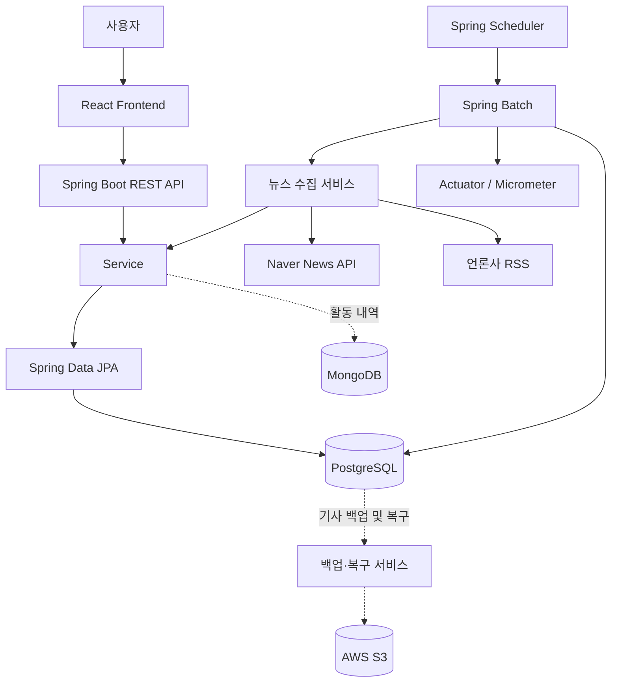
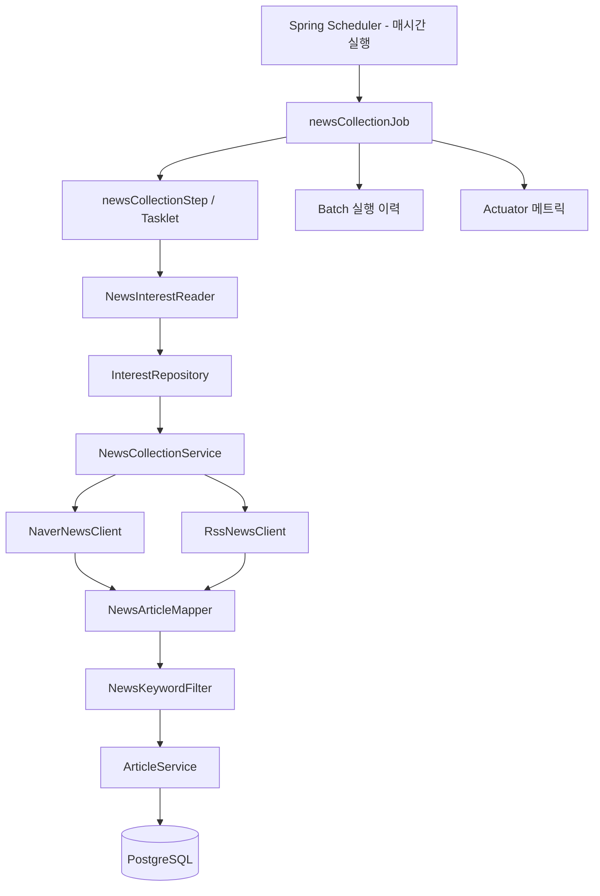
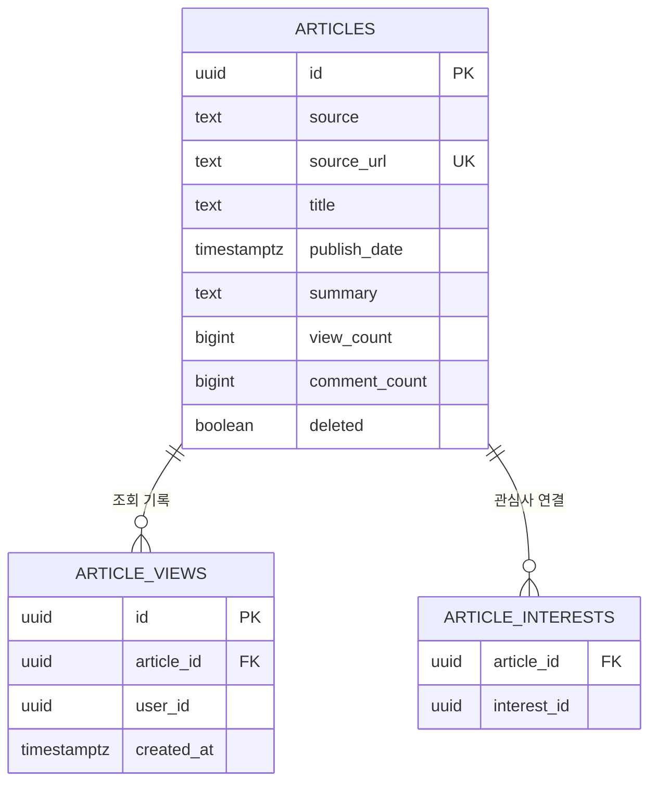
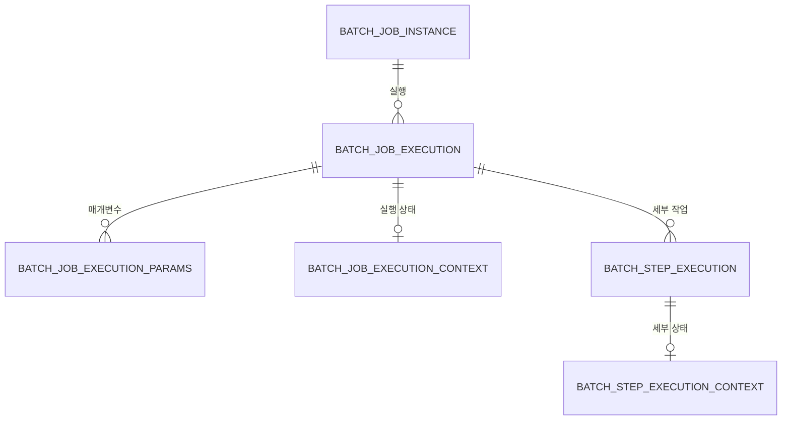

# 2조 - 모뉴 (MONEW)

**관심사 기반 뉴스 수집 및 정보 공유 서비스**

모뉴는 여러 언론사와 뉴스 API에서 기사를 수집하고, 사용자가 구독하는 관심사에 맞는 뉴스를 제공합니다. 사용자는 뉴스를 검색하고 댓글과 좋아요를 통해 다른 사용자와 의견을 나눌 수 있습니다.

PostgreSQL과 MongoDB를 활용해 서비스 데이터와 사용자 활동 내역을 관리하고, AWS S3 기반 기사 백업 및 복구 기능을 통해 데이터 안정성을 확보하는 것을 목표로 합니다.

- 프로젝트 주제: MongoDB 및 PostgreSQL 백업 및 복구 시스템
- 프로젝트 기간: 2026.11.20 ~ 2026.12.10
- 개발 인원: 백엔드 개발자 5명

## 주요 기능

| 기능 | 설명 |
| --- | --- |
| 사용자 관리 | 회원가입, 로그인, 사용자 정보 수정 및 삭제 |
| 관심사 및 구독 | 관심사와 키워드 관리, 관심사 구독 및 취소 |
| 뉴스 수집 | 네이버 뉴스 API 및 RSS 기반 뉴스 수집, 관심사 키워드 매칭, 중복 저장 방지 |
| 뉴스 기사 관리 | 기사 검색, 필터링, 정렬, 커서 페이지네이션, 상세 조회 및 조회수 관리 |
| 댓글 및 좋아요 | 기사에 대한 댓글 작성 및 의견 공유 |
| 사용자 활동 내역 | MongoDB 기반 사용자 활동 내역 관리 및 조회 |
| 알림 | 관심사 관련 신규 기사 및 사용자 활동 알림 |
| 백업 및 복구 | AWS S3 기반 기사 백업과 날짜별 유실 데이터 복구 |

위 기능은 팀의 전체 개발 범위입니다. 도메인 간 연동 및 배포 검증은 진행 중입니다.

## 팀원 구성

| 팀원 | GitHub | 담당 영역 |
| --- | --- | --- |
| 미기입 | — | 사용자 및 사용자 활동 내역 |
| 미기입 | — | 관심사 및 구독 |
| 최주영 | [ohkr1123-commits](https://github.com/ohkr1123-commits) | 뉴스 기사 및 뉴스 수집 |
| 최태민 | [ctm0522](https://github.com/ctm0522) | 댓글 및 좋아요 |
| 김현수 | [uhae451](https://github.com/uhae451) | 알림 및 기사 백업·복구 |

## 기술 스택

| 구분 | 기술 |
| --- | --- |
| Language | Java 17 |
| Framework | Spring Boot 4.1.2, Spring Web MVC |
| Database & ORM | PostgreSQL 16, Spring Data JPA, MongoDB, Spring Data MongoDB |
| Batch & Scheduling | Spring Batch, Spring Scheduler |
| Monitoring | Spring Boot Actuator, Micrometer |
| External API | Naver News API, RSS, RestClient, ROME 2.1.0 |
| API Documentation | springdoc-openapi, Swagger UI |
| Test | JUnit, Mockito |
| Frontend | React, TypeScript, Vite (제공 프론트엔드) |
| Infrastructure | Docker, Docker Compose |
| Storage & Deployment | AWS S3, AWS ECS, GitHub Actions (팀 개발·배포 목표) |
| Collaboration | Git, GitHub, Notion |

## 시스템 아키텍처

다음은 프로젝트의 목표 아키텍처입니다. PostgreSQL 기반 기사 관리와 뉴스 수집 배치를 구현했으며, MongoDB 활동 내역 및 S3 백업·복구를 포함한 전체 연동은 팀 개발 범위에 포함됩니다.



## 핵심 기능 및 기술 설계

### 뉴스 수집 및 자동화

관심사에 등록된 키워드를 기반으로 외부 뉴스 데이터를 수집하고, 일치하는 기사만 PostgreSQL에 저장합니다.

| 수집 출처 | 수집 방식 |
| --- | --- |
| 네이버 뉴스 | Naver News API / RestClient |
| 한국경제 | RSS / ROME |
| 조선일보 | RSS / ROME |
| 연합뉴스TV | RSS / ROME (서비스 출처명: 연합뉴스) |



- **자동 수집:** Spring Scheduler가 매시간 Spring Batch Job을 실행하도록 구성합니다. 시간 단위 Job Parameter로 동일 시간대의 실행을 식별합니다.
- **데이터 표준화:** 네이버 API와 RSS에서 받은 서로 다른 데이터를 공통 기사 DTO로 변환합니다.
- **관심사 매칭:** 기사 제목 및 요약과 관심사 키워드를 비교하여 일치하는 기사를 선별합니다.
- **중복 방지:** 원본 기사 URL의 유일성 제약조건을 적용하고, 이미 저장된 기사에는 새롭게 일치한 관심사를 병합합니다.
- **장애 대응:** 출처별·기사별 실패를 분리하고 로그를 기록합니다. 전체 수집 또는 저장 실패는 예외로 처리하며, 동시 등록 시 발생하는 중복 URL 충돌은 재시도를 통해 처리합니다.
- **실행 이력:** Spring Batch JDBC 메타데이터에 Job과 Step의 실행 상태를 관리하도록 구성합니다.

Scheduler는 기본 설정에서 비활성화되어 있으며, 외부 API 이용 조건 및 전체 연동 검증 후 활성화합니다.

### 기사 조회 및 데이터 정합성

기사 조회 API는 키워드, 관심사, 출처, 발행일을 기준으로 검색하고 발행일·조회수·댓글수 순으로 정렬할 수 있습니다.

- 커서 기반 페이지네이션과 UUID 보조 정렬을 통해 다음 페이지의 조회 기준을 유지합니다.
- 사용자별 기사 조회 기록을 저장하고, 동일 사용자의 중복 조회수 증가를 방지합니다.
- 논리 삭제된 기사의 재수집을 방지하고, 물리 삭제 시 기사 조회 기록과 관심사 연결 정보를 정리합니다.
- DB 유일성 제약조건, 비관적 락, 트랜잭션을 활용하여 중복 등록 및 동시 수정에 따른 데이터 불일치를 방지하도록 설계합니다.

댓글이 연결된 기사의 물리 삭제 정책은 댓글 도메인과의 연동이 필요합니다.

### 배치 모니터링

Spring Boot Actuator와 Micrometer를 이용하여 뉴스 수집 Job의 실행 횟수와 처리 결과를 확인할 수 있도록 구성합니다.

| 메트릭 | 설명 |
| --- | --- |
| `news.collection.execution` | 배치 실행 횟수 |
| `news.collection.success` | 배치 성공 횟수 |
| `news.collection.failure` | 배치 실패 횟수 |
| `news.collection.saved` | 신규 저장 기사 수 |
| `news.collection.duration` | 배치 실행 소요 시간 |

- 서버 상태: `/actuator/health`
- 메트릭 목록: `/actuator/metrics`
- 개별 메트릭: `/actuator/metrics/{metricName}`

Actuator의 메트릭과 PostgreSQL의 Batch 실행 이력을 함께 활용하도록 설계합니다. 메트릭은 애플리케이션 재시작 시 초기화될 수 있습니다.

## API 명세

REST API는 제공 프론트엔드와 API 명세를 기준으로 구현합니다. 전체 도메인의 API 구성은 다음과 같습니다.

<details>
<summary>사용자 및 사용자 활동 내역 (6개)</summary>

| Method | Endpoint | 설명 |
| --- | --- | --- |
| POST | `/api/users` | 회원가입 |
| POST | `/api/users/login` | 로그인 |
| PATCH | `/api/users/{userId}` | 사용자 정보 수정 |
| DELETE | `/api/users/{userId}` | 사용자 논리 삭제 |
| DELETE | `/api/users/{userId}/hard` | 사용자 물리 삭제 |
| GET | `/api/user-activities/{userId}` | 사용자 활동 내역 조회 |

</details>

<details>
<summary>관심사 및 구독 (6개)</summary>

| Method | Endpoint | 설명 |
| --- | --- | --- |
| GET | `/api/interests` | 관심사 목록 조회 |
| POST | `/api/interests` | 관심사 등록 |
| PATCH | `/api/interests/{interestId}` | 관심사 수정 |
| DELETE | `/api/interests/{interestId}` | 관심사 삭제 |
| POST | `/api/interests/{interestId}/subscriptions` | 관심사 구독 |
| DELETE | `/api/interests/{interestId}/subscriptions` | 관심사 구독 취소 |

</details>

<details>
<summary>뉴스 기사 (6개)</summary>

| Method | Endpoint | 설명 |
| --- | --- | --- |
| GET | `/api/articles` | 기사 목록 조회 및 검색 |
| GET | `/api/articles/{articleId}` | 기사 상세 조회 |
| GET | `/api/articles/sources` | 뉴스 출처 목록 조회 |
| POST | `/api/articles/{articleId}/article-views` | 사용자별 기사 조회 기록 등록 |
| DELETE | `/api/articles/{articleId}` | 기사 논리 삭제 |
| DELETE | `/api/articles/{articleId}/hard` | 기사 물리 삭제 |

기사 목록·상세 조회 및 기사 뷰 등록에는 `Monew-Request-User-ID` 헤더가 필요합니다.

</details>

<details>
<summary>댓글 및 좋아요 (7개)</summary>

| Method | Endpoint | 설명 |
| --- | --- | --- |
| GET | `/api/comments` | 댓글 목록 조회 |
| POST | `/api/comments` | 댓글 등록 |
| PATCH | `/api/comments/{commentId}` | 댓글 수정 |
| DELETE | `/api/comments/{commentId}` | 댓글 논리 삭제 |
| DELETE | `/api/comments/{commentId}/hard` | 댓글 물리 삭제 |
| POST | `/api/comments/{commentId}/comment-likes` | 댓글 좋아요 |
| DELETE | `/api/comments/{commentId}/comment-likes` | 댓글 좋아요 취소 |

</details>

<details>
<summary>알림 및 기사 복구 (4개)</summary>

| Method | Endpoint | 설명 |
| --- | --- | --- |
| GET | `/api/notifications` | 알림 목록 조회 |
| PATCH | `/api/notifications` | 전체 알림 확인 |
| PATCH | `/api/notifications/{notificationId}` | 개별 알림 확인 |
| GET | `/api/articles/restore` | 뉴스 복구 |

</details>

서버 실행 후 [Swagger UI](http://localhost:8080/swagger-ui/index.html)에서 실제 등록된 API의 상세 요청·응답 명세를 확인할 수 있습니다.

## 데이터베이스 설계 (ERD)

### 뉴스 기사 도메인



| 테이블 | 역할 및 제약조건 |
| --- | --- |
| `articles` | 기사 정보 저장 / `UNIQUE(source_url)` |
| `article_views` | 사용자별 조회 기록 / `UNIQUE(article_id, user_id)` |
| `article_interests` | 기사와 관심사의 연결 / `UNIQUE(article_id, interest_id)` |

`user_id`와 `interest_id`는 UUID 기반 논리적 참조입니다. 다른 도메인 테이블에 대한 외래 키 제약은 적용하지 않은 상태이며, 통합 ERD 및 도메인 간 관계는 팀 연동 과정에서 확정합니다.

### Spring Batch 메타데이터



Spring Batch 표준 PostgreSQL 메타데이터 테이블 6개와 Sequence 3개를 사용합니다. 기사 도메인과는 별도의 실행 이력 관리 구조이며 직접적인 외래 키 관계는 없습니다.

- 초기화 SQL: `src/main/resources/db/batch/schema-postgresql.sql`
- 기존 테이블과 Sequence를 유지하도록 `IF NOT EXISTS` 적용
- Spring Boot 시작 시 초기화 SQL을 실행하도록 구성

신규 DB에서의 자동 초기화 및 실제 Job 실행 이력 저장은 통합 검증 대상입니다. 운영 환경의 스키마 변경에는 별도의 마이그레이션 정책이 필요합니다.

## 프로젝트 구조

도메인 단위로 패키지를 구성하고, 각 도메인 내부에서 Controller, Service, Repository, Entity 및 DTO의 책임을 분리합니다.

```text
src/main/
├── java/com/sprint/mission/sb15monewteam02/
│   ├── common/           # 공통 설정, 예외 처리 등
│   └── article/          # 뉴스 기사 도메인
│       ├── controller/   # 기사 REST API
│       ├── service/      # 기사 비즈니스 로직
│       ├── repository/   # JPA 저장 및 조회
│       ├── entity/       # 기사 및 기사 조회 기록
│       ├── dto/          # 요청 및 응답 데이터
│       ├── exception/    # 기사 관련 예외
│       └── collection/   # 뉴스 수집 및 배치
│           ├── client/   # Naver API, RSS 연동
│           ├── dto/      # 외부 뉴스 데이터
│           ├── filter/   # 관심사 키워드 필터링
│           ├── mapper/   # 기사 데이터 변환
│           ├── service/  # 관심사 조회, 수집 및 저장
│           └── batch/    # 뉴스 수집 Tasklet 등
└── resources/
    ├── application.yaml
    ├── application-dev.yaml
    ├── application-prod.yaml
    ├── db/batch/schema-postgresql.sql
    └── static/           # 프론트엔드 정적 리소스
```

뉴스 기사 담당 영역을 중심으로 표시한 구조입니다. 사용자, 관심사, 활동 내역, 댓글, 알림 및 백업·복구 도메인의 전체 패키지 구조는 팀 통합에 따라 확정합니다.

## 실행 방법

### 사전 준비

- Java 17
- Docker 및 Docker Compose
- Naver News API 인증정보 (네이버 수집 기능 사용 시)

### 1. 환경변수 설정

프로젝트 루트의 `.env.example`을 참고하여 `.env`를 작성합니다. 다음은 로컬 Spring Boot 실행에 필요한 주요 환경변수입니다.

| 환경변수 | 설명 |
| --- | --- |
| `DB_USER` | Docker PostgreSQL 사용자 |
| `DB_PASSWORD` | Docker PostgreSQL 비밀번호 |
| `SPRING_DATASOURCE_URL` | `jdbc:postgresql://localhost:5433/monew_db` |
| `SPRING_DATASOURCE_USERNAME` | Spring Boot DB 사용자 (`DB_USER`와 동일) |
| `SPRING_DATASOURCE_PASSWORD` | Spring Boot DB 비밀번호 (`DB_PASSWORD`와 동일) |
| `SPRING_JPA_HIBERNATE_DDL_AUTO` | 로컬 개발 시 `update` 권장 |
| `NAVER_CLIENT_ID` | 네이버 뉴스 API 인증 ID |
| `NAVER_CLIENT_SECRET` | 네이버 뉴스 API 인증 키 |
| `NAVER_NEWS_URL` | 네이버 뉴스 API 요청 주소 |
| `ARTICLE_TEST_DATABASE_PASSWORD` | 별도 기사 테스트 DB 비밀번호 |

인증정보 및 비밀번호는 Git에 커밋하지 않습니다. IntelliJ에서 직접 실행하는 경우 Run/Debug Configuration의 환경변수 또는 EnvFile 설정을 통해 `.env`의 값을 전달합니다. `.env` 파일을 만드는 것만으로 로컬 Spring Boot에 자동 적용되는 것은 아닙니다.

### 2. PostgreSQL 실행

```bash
docker compose up -d db
```

호스트에서 PostgreSQL에 접속하는 포트는 `5433`, 데이터베이스 이름은 `monew_db`입니다.

### 3. Spring Boot 실행

IntelliJ에서 `Sb15MonewTeam02Application`을 실행하거나, 위 환경변수를 실행 환경에 설정한 뒤 Gradle Wrapper를 사용합니다.

```bash
./gradlew bootRun
```

Windows PowerShell에서는 `./gradlew.bat bootRun`을 사용합니다.

> 기존 공통 JPA 설정의 `ddl-auto: create`는 애플리케이션 시작 시 테이블을 재생성할 수 있습니다. 기존 개발 데이터를 유지하려면 실행 환경에서 `SPRING_JPA_HIBERNATE_DDL_AUTO=update`를 설정하고 실제 적용 여부를 확인해야 합니다. 운영 DB에는 검토 없이 `create` 또는 `update`를 사용하지 않습니다.

### 4. 서비스 확인

| 구분 | 주소 |
| --- | --- |
| 서비스 | [localhost:8080](http://localhost:8080) |
| Swagger UI | [API 문서](http://localhost:8080/swagger-ui/index.html) |
| OpenAPI | [JSON 명세](http://localhost:8080/v3/api-docs) |
| Health | [서버 상태](http://localhost:8080/actuator/health) |
| Metrics | [메트릭 목록](http://localhost:8080/actuator/metrics) |

Spring Batch Job의 시작 시 자동 실행과 뉴스 Scheduler는 기본적으로 비활성화되어 있습니다. 실제 외부 뉴스 수집은 제공처의 이용 조건을 확인한 환경에서 활성화합니다.

## 테스트 및 품질 관리

JUnit과 Mockito를 이용해 서비스 비즈니스 로직, 예외 처리 및 외부 뉴스 수집 흐름을 검증합니다. PostgreSQL 관련 테스트는 개발 DB와 분리된 테스트 환경에서 수행합니다.

| 테스트 영역 | 검증 내용 |
| --- | --- |
| Entity / DTO | 데이터 유효성 및 상태 변경 |
| Repository | 기사 저장, 검색, 정렬 및 DB 제약조건 |
| Service | 중복 저장 방지, 관심사 병합, 조회수 관리, 예외 처리 |
| Controller | REST API 요청·응답 및 공통 예외 처리 |
| 외부 뉴스 수집 | 뉴스 변환, 키워드 매칭, 수집·저장 실패 대응 |
| Batch / Scheduler | Tasklet 실행 흐름, Job 실행 요청 및 예외 처리 |
| Monitoring | 실행 결과 기록 및 커스텀 메트릭 |

네이버 API 실제 호출은 선택적으로 실행하는 테스트로 검증하며, 외부 RSS 테스트는 네트워크 및 제공처 상태의 영향을 받습니다. 외부 API를 모킹하는 단위 테스트는 실제 네트워크를 사용하지 않습니다.

**검증 범위:** 기사 관련 주요 테스트 및 네이버 API 응답 변환을 확인했습니다. 실제 Batch의 DB 실행 이력·기사 저장, 자동 초기화, 프론트엔드 통합, 전체 테스트 커버리지는 최종 검증이 필요합니다.

테스트 실행 전에 데이터소스가 개발용 DB나 운영 DB가 아닌 별도 테스트 DB를 가리키는지 반드시 확인합니다. 팀의 테스트 커버리지 목표는 80% 이상이며, 측정 결과는 최종 검증 후 반영합니다.

## 협업 방식

| 브랜치 | 역할 |
| --- | --- |
| `main` | 최종 제출 및 배포 |
| `develop` | 팀 기능 통합 |
| `feature/*` | 개별 기능 개발 |
| `fix/*` | 버그 수정 |

기능 브랜치에서 작업한 뒤 `develop`으로 Pull Request를 작성하고 팀 리뷰를 거쳐 병합합니다. 공통 API 응답, 데이터베이스 스키마 및 도메인 간 연동 변경은 담당자 간 협의를 거칩니다.
