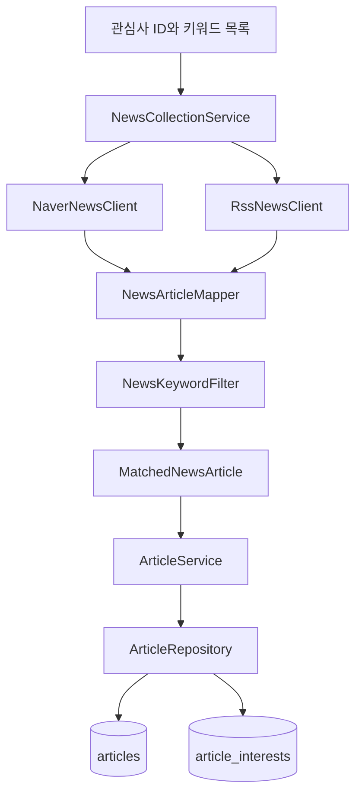
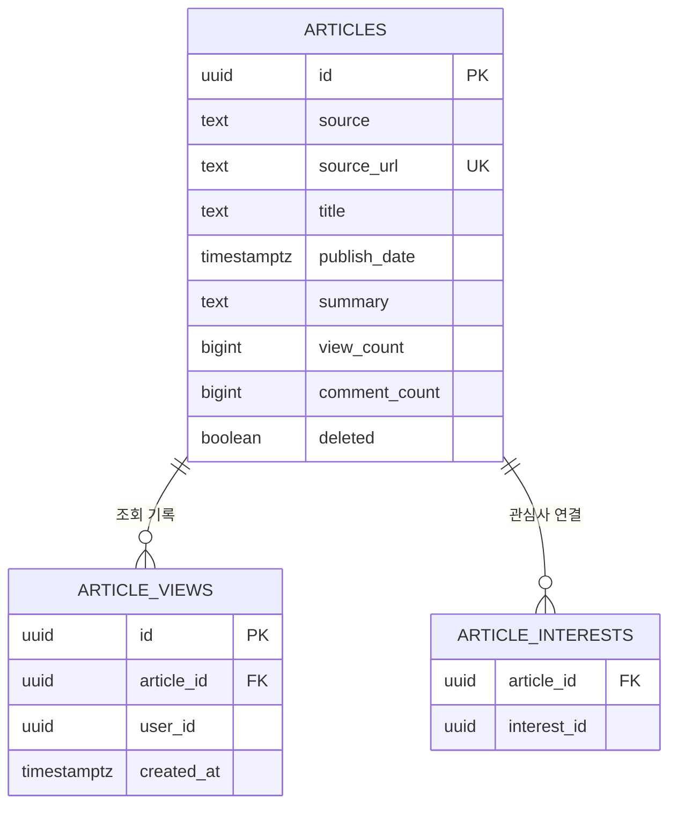
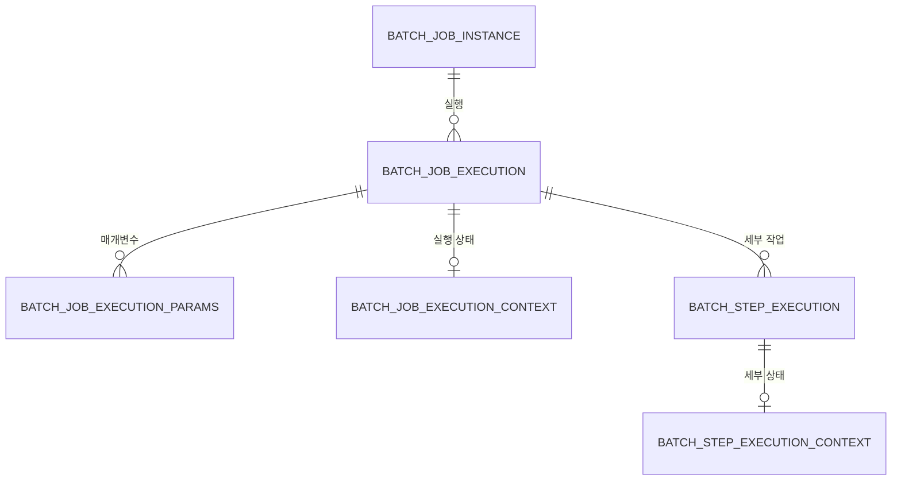

# 2조 - 모뉴 MONEW

> 팀 협업 문서: Notion

## 팀원 구성

| 이름 | GitHub | 담당 영역 |
| --- | --- | --- |
| (TODO: 팀원 1) | (TODO: GitHub 링크) | 사용자 및 사용자 활동 내역 |
| (TODO: 팀원 2) | (TODO: GitHub 링크) | 관심사 및 구독 |
| 최주영 | [ohkr1123-commits](https://github.com/ohkr1123-commits) | 뉴스 기사 및 뉴스 수집 |
| 최태민 | [Taemin02](https://github.com/ctm0522) | 댓글 및 좋아요 |
| 김현수 | [uhae451](https://github.com/uhae451) | 알림 및 기사 백업·복구 |

## 프로젝트 소개

**모뉴는 여러 출처의 뉴스를 수집하여 관심사에 맞는 기사를 제공하고, 댓글과 좋아요로 의견을 나누는 뉴스 서비스입니다.**

Naver News API와 한국경제·조선일보·연합뉴스 RSS를 통합하는 수집 파이프라인을 구현합니다. PostgreSQL과 MongoDB를 함께 활용하고, AWS S3 기반 기사 백업 및 날짜별 유실 데이터 복구를 통해 데이터 안정성을 확보하는 것을 목표로 합니다.

- 프로젝트 주제: MongoDB 및 PostgreSQL 백업 및 복구 시스템
- 프로젝트 기간: 2026.11.20 ~ 2026.12.10
- 개발 인원: 백엔드 개발자 5명

### 주요 기능 및 개발 목표

| 영역 | 개발 내용 |
| --- | --- |
| 사용자 관리 | 회원가입, 로그인, 사용자 정보 수정, 논리·물리 삭제 |
| 관심사 관리 | 관심사 및 키워드 관리, 관심사 구독·구독 취소 |
| 뉴스 기사 관리 | 기사 검색·필터·정렬, 상세 조회, 기사 뷰 등록, 논리·물리 삭제 |
| 뉴스 수집 | Naver API 및 RSS 연동, 관심사 키워드 매칭, 중복 수집 방지, 관심사 병합, 주기적 수집(예정) |
| 댓글 관리 | 댓글 등록·수정·삭제, 좋아요 및 좋아요 취소 |
| 활동 내역 관리 | MongoDB를 활용한 사용자 활동 내역 저장 및 조회 최적화 |
| 알림 관리 | 알림 생성·목록 조회·확인, 오래된 알림 정리 |
| 백업 및 복구 | S3 기사 백업, 날짜별 백업과 현재 DB 비교, 유실 기사 복구 |

## 기술 스택

아래는 프로젝트에서 사용할 기술입니다. 배치, API 문서화 및 배포 환경은 개발 과정에서 구성할 예정입니다.

| 구분 | 기술 |
| --- | --- |
| Language | Java 17 |
| Framework | Spring Boot 4.1.2 |
| Database & ORM | PostgreSQL, Spring Data JPA, MongoDB, Spring Data MongoDB |
| Batch & Scheduling | Spring Batch, Spring Scheduler (적용 예정) |
| Monitoring | Spring Boot Actuator (적용 예정) |
| Documentation | springdoc-openapi, Swagger UI |
| Test | JUnit, Mockito, JaCoCo |
| Storage | AWS S3 |
| Infra & CI/CD | AWS ECS, GitHub Actions |
| External API | Naver News API, 한국경제·조선일보·연합뉴스TV RSS (서비스 출처명: 연합뉴스), RestClient, ROME 2.1.0 |
| 제공 프론트엔드 | React, TypeScript, Vite |
| 협업 도구 | Git, GitHub, (TODO: 팀 협업 도구) |

## 협업 규칙

다음은 협업 규칙 초안이며, 팀 합의 후 확정합니다.

### Git 브랜치 전략

| 브랜치 | 용도 |
| --- | --- |
| `main` | 최종 제출 및 배포용 브랜치 |
| `develop` | 개발 내용을 통합하고 테스트하는 브랜치 |
| `feature/기능명` | 개별 기능 개발용 브랜치 |
| `fix/버그명` | 개발 중 발견한 버그 수정용 브랜치 |

- `feature/*`, `fix/*` 브랜치는 `develop`에서 생성하고, `develop`으로 PR을 올립니다.
- `main`에는 `develop`을 병합하는 릴리스 PR만 올립니다.

### 리뷰 규칙

- PR은 팀원 1명 이상의 코드 리뷰와 Approve를 받은 뒤 Merge합니다.
- PR에는 변경 목적, 주요 구현 내용, 테스트 결과를 작성합니다.
- 공통 응답 형식, DB 스키마, 도메인 간 연동 방식의 변경은 관련 담당자와 먼저 협의합니다.

### 개발 및 테스트 규칙

- 각 담당자는 기능 구현부터 유효성 검사, 예외 처리, 로그, 테스트, API 문서화, 프론트엔드 연동까지 책임집니다.
- TDD 사이클을 적용하고 테스트 커버리지 80% 이상을 목표로 합니다. 측정 범위와 기준은 팀에서 합의합니다.
- CI/CD 초기 구성과 배포 검증은 공동으로 진행합니다.
- API 경로, 요청·응답 형식, 커서 페이지네이션은 제공된 API 명세를 기준으로 구현합니다.

## 팀원별 구현 기능 상세

아래는 총 29개 API에 대한 담당 계획입니다. 팀원 확정 후 이름과 GitHub 계정을 기입하고, 구현 결과 화면이나 GIF를 추가합니다.

### 1번 사용자 및 사용자 활동 내역

담당자: (TODO: 이름 / GitHub)

| Method | 경로 | 기능 |
| --- | --- | --- |
| POST | `/api/users` | 회원가입 |
| POST | `/api/users/login` | 로그인 |
| PATCH | `/api/users/{userId}` | 사용자 정보 수정 |
| DELETE | `/api/users/{userId}` | 사용자 논리 삭제 |
| DELETE | `/api/users/{userId}/hard` | 사용자 물리 삭제 |
| GET | `/api/user-activities/{userId}` | 사용자 활동 내역 조회 |

- MongoDB 활동 내역 모델링 및 저장·조회
- 각 도메인에서 발생하는 활동 정보 반영
- 사용자 삭제 시 연관 데이터 처리 정책 협의

### 2번 관심사 및 구독

담당자: (TODO: 이름 / GitHub)

| Method | 경로 | 기능 |
| --- | --- | --- |
| GET | `/api/interests` | 관심사 목록 조회 |
| POST | `/api/interests` | 관심사 등록 |
| PATCH | `/api/interests/{interestId}` | 관심사 정보 수정 |
| DELETE | `/api/interests/{interestId}` | 관심사 물리 삭제 |
| POST | `/api/interests/{interestId}/subscriptions` | 관심사 구독 |
| DELETE | `/api/interests/{interestId}/subscriptions` | 관심사 구독 취소 |

- 관심사·키워드·구독 관계 설계
- 관심사 검색·정렬 및 커서 페이지네이션
- 기사 담당자와 관심사별 기사 연결 기준 협의

### 3번 뉴스 기사 및 뉴스 수집

담당자: 최주영 | [ohkr1123-commits](https://github.com/ohkr1123-commits)

| Method | 경로 | 기능 |
| --- | --- | --- |
| GET | `/api/articles` | 뉴스 기사 목록 조회 |
| GET | `/api/articles/{articleId}` | 뉴스 기사 단건 조회 |
| GET | `/api/articles/sources` | 출처 목록 조회 |
| POST | `/api/articles/{articleId}/article-views` | 기사 뷰 등록 |
| DELETE | `/api/articles/{articleId}` | 뉴스 기사 논리 삭제 |
| DELETE | `/api/articles/{articleId}/hard` | 뉴스 기사 물리 삭제 |

#### 주요 구현 내용 (2026.11.26 기준)

**뉴스 기사 관리**

- 기사 제목·요약 키워드 검색, 관심사·출처·발행일 필터링
- 발행일·조회수·댓글수 정렬 및 커서 기반 페이지네이션 (UUID를 보조 정렬 기준으로 사용)
- 기사 상세 조회와 사용자별 조회 여부(`viewedByMe`) 반환
- 동일 사용자 중복 조회 방지 (DB 유일성 제약조건 및 비관적 락 적용)
- 기사 논리·물리 삭제 및 기사 조회 기록·관심사 연결 정보 정리
- 기사 목록·상세 조회의 사용자 ID 헤더 필수화 및 팀 공통 예외 응답 적용
- 댓글이 존재하는 기사의 물리 삭제는 댓글 담당자와 연동하기 전까지 제한

**외부 뉴스 수집 및 저장**

- `RestClient`를 이용한 네이버 뉴스 API 요청과 ROME 라이브러리를 이용한 RSS 파싱
- 한국경제·조선일보·연합뉴스TV RSS 수집 클라이언트 및 호출 테스트 작성
- 외부 뉴스 데이터를 `ArticleCreateRequest`로 통합 변환
- 기사 제목 또는 요약과 관심사 키워드를 비교하여 일치하는 기사만 선별 (영문 대소문자 및 앞뒤 공백 보정)
- `MatchedNewsArticle`로 기사 정보와 일치하는 관심사 UUID 목록 연결
- 원본 URL 기준 중복 저장 방지, 기존 기사에는 신규 관심사 ID 병합, 논리 삭제 기사 재등록 방지
- 출처·키워드별 수집 실패와 개별 기사 저장 실패 로깅 및 나머지 작업 계속 수행
- `NewsCollectionService.collectAndSave()`에서 수집 → 변환 → 필터링 → 저장 흐름 통합
- 네이버 API 인증정보가 없으면 네이버 수집만 생략하여 다른 기능의 개발·테스트에 영향이 없도록 구성

#### 뉴스 수집 처리 흐름



현재 관심사 ID·키워드 목록과 RSS 출처·주소 목록을 매개변수로 전달하는 구조이며, 실제 관심사 Repository 조회 및 자동 수집 실행은 연동 예정입니다.

#### 테스트 및 검증

| 테스트 클래스 | 테스트 수 | 검증 범위 |
| --- | ---: | --- |
| ArticleEntityTest | 5 | 기사 엔티티 유효성 및 상태 변경 |
| ArticleSearchRequestTest | 4 | 검색 요청 조건 검증 |
| ArticleRepositoryTest | 6 | 기사 저장·검색 및 필터링 |
| ArticleServiceTest | 25 | 기사 관리, 중복 저장 방지, 관심사 병합 |
| ArticleControllerTest | 15 | REST API, 필수 헤더, 공통 예외 응답 |
| ArticlePersistenceTest | 11 | PostgreSQL 저장·제약조건·동시성·관심사 병합 |
| NewsArticleMapperTest | 2 | 네이버·RSS 데이터 변환 |
| NewsKeywordFilterTest | 10 | 관심사 키워드 필터링 및 ID 매칭 |
| NewsCollectionServiceTest | 14 | 수집·선별·저장 흐름 및 실패 처리 (Mockito) |
| NaverNewsClientTest | 1 | 실제 네이버 뉴스 API 호출 (선택 실행) |
| RssNewsClientTest | 3 | 실제 RSS 호출 (외부 네트워크 필요) |
| **합계** | **96** | **첨부 소스 기준 작성된 테스트 메서드 수** |

- 기사 관리 및 수집 관련 주요 단위·통합 테스트는 개발 과정에서 통과를 확인했습니다. 위 합계는 작성된 테스트 수이며, 외부 API 테스트까지 모두 실행·통과했다는 의미는 아닙니다.
- 실제 PostgreSQL 테스트는 개발 DB와 분리된 `article_test_db` / `article_test` 스키마를 사용하도록 구성했습니다. 실행 전 데이터소스가 테스트 DB를 가리키는지 확인해야 합니다.
- 네이버 호출 테스트는 `RUN_NAVER_API_TEST=true`일 때만 실행되며 API 인증정보가 필요합니다. RSS 호출 테스트는 외부 서비스 상태에 영향을 받습니다.
- Mockito 테스트는 외부 API를 호출하지 않고 가상 데이터를 사용합니다.

#### 환경변수 및 외부 연동

| 환경변수 | 용도 |
| --- | --- |
| `NAVER_CLIENT_ID` | 네이버 API 인증 ID |
| `NAVER_CLIENT_SECRET` | 네이버 API 인증 키 |
| `NAVER_NEWS_URL` | 네이버 뉴스 API 요청 주소 |
| `ARTICLE_TEST_DATABASE_PASSWORD` | 기사 테스트 DB 접속 비밀번호 |

인증정보는 `.env` 등 로컬 환경 설정으로 관리하며 Git에 커밋하지 않습니다. Docker Compose는 네이버 API 환경변수를 애플리케이션 컨테이너에 전달합니다. IntelliJ에서 직접 실행할 때는 실행 환경에 해당 변수를 설정합니다.

#### 추가 개발 및 팀 연동 예정

- [ ] 실제 관심사 Repository에서 관심사 ID 및 키워드 조회
- [ ] 외부 뉴스 데이터 저장·제공 이용 조건 확인 및 출처별 호출 검증
- [ ] 개별 기사 변환 오류, 동시 신규 기사 등록 충돌 및 외부 호출 안정성 보완
- [ ] Spring Batch Job·Step 구성 및 JDBC 메타데이터 관리
- [ ] Scheduler를 활용한 매시간 자동 뉴스 수집
- [ ] Actuator 기반 뉴스 수집 상태·처리 결과 모니터링
- [ ] 사용자·관심사·댓글·알림 및 백업·복구 담당자와 연동 검증
- [ ] 로그인 기능 통합 이후 실제 프론트엔드 연동 및 최종 테스트

Spring Batch 적용 시 표준 메타데이터 테이블은 팀 공통 인프라로 구성하고, 백업·복구 담당자와 설정 및 실행 정책을 협의합니다.

### 4번 댓글 및 좋아요

담당자: (TODO: 이름 / GitHub)


| Method | 경로 | 기능 |
| --- | --- | --- |
| GET | `/api/comments` | 댓글 목록 조회 |
| POST | `/api/comments` | 댓글 등록 |
| PATCH | `/api/comments/{commentId}` | 댓글 정보 수정 |
| DELETE | `/api/comments/{commentId}` | 댓글 논리 삭제 |
| DELETE | `/api/comments/{commentId}/hard` | 댓글 물리 삭제 |
| POST | `/api/comments/{commentId}/comment-likes` | 댓글 좋아요 |
| DELETE | `/api/comments/{commentId}/comment-likes` | 댓글 좋아요 취소 |

- 좋아요 중복 방지 및 동시성 처리
- 댓글 정렬 및 커서 페이지네이션
- 댓글·좋아요 활동 정보 전달 및 알림 담당자와 연동 협의

### 5번 알림 및 기사 백업과 복구

담당자: 김현수 | [uhae451](https://github.com/uhae451)

| Method | 경로 | 기능 |
| --- | --- | --- |
| GET | `/api/notifications` | 알림 목록 조회 |
| PATCH | `/api/notifications` | 전체 알림 확인 |
| PATCH | `/api/notifications/{notificationId}` | 알림 확인 |
| GET | `/api/articles/restore` | 뉴스 복구 |

- 상세 요구사항에 따른 알림 생성 및 커서 페이지네이션
- 오래된 알림 정리 배치
- S3 기사 백업 및 날짜별 유실 데이터 비교·복구
- 백업·복구 작업의 실패 및 재실행 처리

백업·복구 담당 범위는 기사 중심으로 계획합니다. 전체 PostgreSQL·MongoDB 백업이 요구되는 경우 상세 요구사항에 맞춰 범위와 업무량을 재조정합니다.

## ER 다이어그램

### 뉴스 기사 도메인 (2026.11.26 기준)



| 테이블 | 주요 제약조건 및 역할 |
| --- | --- |
| `articles` | `UNIQUE(source_url)` — 동일 기사 중복 저장 방지 |
| `article_views` | `UNIQUE(article_id, user_id)` — 사용자별 중복 조회 방지 |
| `article_interests` | `UNIQUE(article_id, interest_id)` — 기사·관심사 관계 중복 방지 (`@ElementCollection`) |

`user_id`와 `interest_id`는 현재 UUID 기반의 논리적 참조이며, 다른 도메인 테이블에 대한 외래 키 제약은 아직 적용하지 않았습니다. 뉴스 수집 로직은 기존 기사 테이블을 재사용하므로 별도 수집 테이블을 추가하지 않습니다.

### Spring Batch 메타데이터 (추가 예정)

JDBC JobRepository를 사용하는 경우 Spring Batch 표준 스키마의 6개 테이블을 공통 인프라로 구성할 예정입니다.



위 스키마는 기사 테이블과 직접적인 외래 키 관계가 없으며, 실제 적용 버전 및 초기화 방식은 배치 설정 단계에서 확정합니다.

### 팀 전체 ERD

(TODO: PostgreSQL 전체 통합 ERD 이미지 또는 Mermaid 다이어그램)

(TODO: MongoDB 활동 내역 문서 구조 및 원본 데이터와의 연결 방식)

엔티티 관계, 삭제 정책, 기사 중복 판단 기준을 합의한 뒤 반영합니다.

## 파일 구조

아래는 도메인별 개발을 위한 목표 구조이며, 기사 파트는 2026.11.26 기준 실제 패키지 구성을 반영했습니다. 나머지 도메인은 팀별 구현 및 통합 과정에서 확정합니다.

```text
sb15-monew-team02/
├── src/main/
│   ├── java/com/sprint/mission/sb15monewteam02/
│   │   ├── Sb15MonewTeam02Application.java
│   │   ├── common/          # 공통 설정·응답·예외 처리
│   │   ├── user/            # [1번] 사용자
│   │   ├── useractivity/    # [1번] MongoDB 사용자 활동 내역
│   │   ├── interest/        # [2번] 관심사·키워드·구독
│   │   ├── article/         # [3번] 기사·기사 뷰
│   │   │   └── collection/  # [3번] 외부 뉴스 연동·수집 및 저장
│   │   ├── comment/         # [4번] 댓글·좋아요
│   │   ├── notification/    # [5번] 알림·정리 배치
│   │   └── backup/          # [5번] 기사 백업·복구
│   └── resources/
│       ├── application.yaml
│       ├── application-dev.yaml
│       ├── application-prod.yaml
│       └── static/          # 제공된 프론트엔드 정적 리소스
├── src/test/java/           # 담당 기능별 테스트
├── frontend/               # 제공된 프론트엔드 소스
├── .env.example            # 환경변수 설정 예시
├── docker-compose.yml      # 애플리케이션·PostgreSQL 실행 환경
├── Dockerfile
├── build.gradle
└── README.md
```

## 파일 상세 구조

기능 변경 시 관련 코드를 함께 찾고 담당 범위를 구분할 수 있도록 도메인형 패키지를 사용합니다. 기사 도메인은 현재 구현된 구조를 기준으로 작성했으며, 다른 도메인은 설계 초안입니다. 필요하지 않은 계층이나 빈 패키지는 미리 생성하지 않습니다.

### 공통 코드

```text
common/
├── config/                 # API 문서화 등 공통 Spring 설정
├── dto/                    # 공통 커서 페이지 응답
├── exception/              # 에러 코드·커스텀 예외·전역 예외 처리
└── pagination/             # 커서 처리 공통 로직
```

### PostgreSQL 기반 기능

`user`, `interest`, `article`, `comment`, `notification`은 다음 구성을 기본으로 합니다. 구독·기사 뷰·좋아요는 각각 관련 도메인 안에서 관리하는 것을 초기안으로 합니다.

```text
도메인/
├── controller/             # 요청 수신·응답 반환
├── service/                # 비즈니스 규칙·트랜잭션 처리
├── repository/             # DB 저장·검색·조회
├── entity/                 # JPA 엔티티
├── dto/                    # API 요청·응답
└── mapper/                 # 엔티티와 DTO 변환
```

### MongoDB 사용자 활동 내역

```text
useractivity/
├── controller/             # 사용자 활동 내역 조회 API
├── service/                # 활동 내역 반영 및 조회
├── repository/             # MongoDB 저장·조회
├── document/               # 활동 내역 조회용 문서 모델
├── dto/                    # 활동 내역 응답
└── mapper/                 # 문서와 응답 DTO 변환
```

### 뉴스 기사 및 외부 뉴스 수집 (실제 구조)

```text
article/
├── controller/
│   └── ArticleController.java
├── dto/
│   ├── ArticleCreateRequest.java
│   ├── ArticleOrder.java
│   ├── ArticlePage.java
│   ├── ArticleResponse.java
│   ├── ArticleSearchRequest.java
│   ├── ArticleSlice.java
│   └── ArticleViewResponse.java
├── entity/
│   ├── Article.java
│   └── ArticleView.java
├── exception/
│   ├── ArticleNotFoundException.java
│   └── DuplicateArticleException.java
├── repository/
│   ├── ArticleRepository.java
│   ├── ArticleSearchRepository.java
│   ├── ArticleSearchRepositoryImpl.java
│   └── ArticleViewRepository.java
├── service/
│   └── ArticleService.java
└── collection/                          # 외부 뉴스 수집 전담
    ├── client/
    │   ├── NaverNewsClient.java
    │   └── RssNewsClient.java
    ├── dto/
    │   ├── MatchedNewsArticle.java
    │   ├── NaverNewsItem.java
    │   ├── NaverNewsResponse.java
    │   └── RssNewsItem.java
    ├── filter/
    │   └── NewsKeywordFilter.java
    ├── mapper/
    │   └── NewsArticleMapper.java
    └── service/
        └── NewsCollectionService.java
```

`article`은 기사 관리 및 DB 저장을 담당하며, 하위 `collection`은 외부 API·RSS 수집, 데이터 변환, 키워드 필터링 및 저장 연동을 담당합니다. `batch/`와 `scheduler/`는 자동 수집 기능을 구현할 때 `article/collection` 아래에 추가할 예정입니다.

### 뉴스 기사 테스트 (실제 구조)

```text
src/test/java/com/sprint/mission/sb15monewteam02/article/
├── ArticlePersistenceTest.java
├── collection/
│   ├── client/
│   │   ├── NaverNewsClientTest.java
│   │   └── RssNewsClientTest.java
│   ├── filter/
│   │   └── NewsKeywordFilterTest.java
│   ├── mapper/
│   │   └── NewsArticleMapperTest.java
│   └── service/
│       └── NewsCollectionServiceTest.java
├── controller/
│   └── ArticleControllerTest.java
├── entity/
│   ├── ArticleEntityTest.java
│   └── ArticleSearchRequestTest.java
├── repository/
│   └── ArticleRepositoryTest.java
└── service/
    └── ArticleServiceTest.java
```

### 기사 백업 및 복구

```text
backup/
├── controller/             # GET /api/articles/restore
├── service/                # 백업 생성·유실 비교·복구
├── storage/                # S3 백업 파일 저장·조회
├── dto/                    # 백업 데이터 및 복구 결과
├── batch/                  # 백업 Job·Step 구성
└── scheduler/              # 백업 작업 실행 시점 관리
```

알림 정리 작업은 `notification` 내부의 `batch`, `scheduler`에서 관리합니다. 기사 복구 API는 `backup`에서 담당하고, 기사 저장 및 조회는 `article` 담당자와 합의한 인터페이스를 통해 연동합니다.

## 공통 응답 사용법

각 파트는 `frontend/src/api/해당영역/types.ts`의 응답 필드에 맞춰 DTO를 작성하고,
`ResponseEntity`의 본문에 그대로 넣습니다. 제공 프론트는 응답 본문을 바로 읽으므로
별도의 `data` 객체로 감싸지 않습니다.

```java
// 단건 DTO 또는 배열
return ResponseEntity.ok(result);

// 관심사·기사·댓글·알림 목록
return ResponseEntity.ok(new CursorPageResponse<>(
    content, nextCursor, nextAfter, size, totalElements, hasNext));
```

- 목록의 공통 필드는 `content`, `nextCursor`, `nextAfter`, `size`, `totalElements`, `hasNext`입니다. 기사 파트의 `ArticlePage`도 동일한 필드를 반환합니다.
- `nextCursor`, `nextAfter`는 문자열 또는 null이며, 페이지 값의 계산은 각 담당자가 구현합니다.
- HTTP 상태는 과제 명세에 맞춰 `ResponseEntity.status(status)`로 지정합니다.
- 본문 없는 응답은 `ResponseEntity.status(status).build()`를 사용합니다.
- 오류는 `ErrorResponse` 틀을 사용합니다. 프론트는 최상위 `message`를 읽으며,
  오류 코드·메시지·HTTP 상태는 팀에서 정합니다.

## 구현 홈페이지

- 서비스: (배포 링크)
- API 문서: 서버 실행 후 [Swagger UI](http://localhost:8080/swagger-ui/index.html)
- OpenAPI 명세: 서버 실행 후 [JSON 명세](http://localhost:8080/v3/api-docs)
- 구현된 컨트롤러를 기준으로 API 문서가 자동 생성됩니다. DB 등 서버 실행에 필요한 설정을 먼저 완료해야 합니다.
- 주요 화면: (TODO: 구현 화면 또는 GIF)

## 프로젝트 회고록

- 발표자료: (TODO: 링크 또는 첨부파일)
- 팀 회고: (TODO: 협업 과정, 기술 선택 이유, 개선 사항)
- 개인 회고: (TODO: 팀원별 회고 링크)
